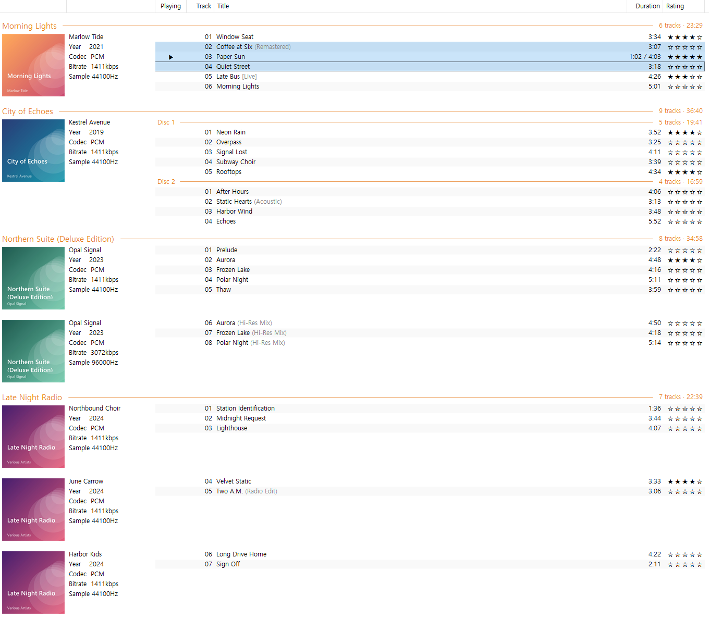

# fb2k-components

[English](README.md) · **한국어**

foobar2000 64비트용 컴포넌트 모음입니다. 모두 처음부터 새로 만들었습니다.

| 컴포넌트 | 설명 | 버전 |
|---|---|---|
| [GroupPlaylist](components/foo_groupplaylist/README.ko.md) (`foo_groupplaylist`) | 곡을 앨범 같은 단위로 묶고 묶음마다 앨범아트를 보여 주는 재생목록 보기. SimPlaylist의 64비트 대안. | 0.11.1 |

컴포넌트는 [Releases](https://github.com/ChickenBrocolli/fb2k-components/releases) 페이지에서 받습니다. 릴리스 이름에는 컴포넌트 이름이 붙습니다(예: `foo_groupplaylist-v0.11.1`). 설치와 사용법은 각 컴포넌트의 README에 있습니다.

이 컴포넌트들은 대신하려는 원래 컴포넌트의 원작자와 관계가 없습니다.

## 필요한 것

- foobar2000 v2.0 이상, 64비트
- Default UI(기본 화면)

## 폴더 구성

| 폴더 | 내용 |
|---|---|
| `components/<이름>/src` | 컴포넌트 소스 코드 |
| `components/<이름>/tests` | 표준 라이브러리만으로 빌드되는 자동 테스트 |
| `tools` | 빌드, 테스트, 패키지 스크립트(PowerShell) |

## 빌드

C++ 데스크톱 개발 도구가 포함된 Visual Studio 2022(또는 Build Tools)가 필요합니다.

1. [foobar2000 SDK](https://www.foobar2000.org/SDK)를 `foobar2000_SDK/`에 넣습니다.
2. [WTL NuGet 패키지](https://www.nuget.org/packages/wtl)(버전 10)의 내용을 `third_party/wtl/`에 넣습니다.
3. PowerShell에서 `tools\package.ps1`을 실행합니다. 컴포넌트 파일이 `dist\`에 만들어집니다.

`tools\build-and-deploy.ps1`은 빌드한 DLL을 시험용 휴대용 foobar2000(`foobar2000_x64/`)에 복사합니다.

## 라이선스

[MIT 라이선스](LICENSE). 함께 쓴 라이브러리의 라이선스는 [THIRD-PARTY-NOTICES.txt](THIRD-PARTY-NOTICES.txt)에 있습니다.
