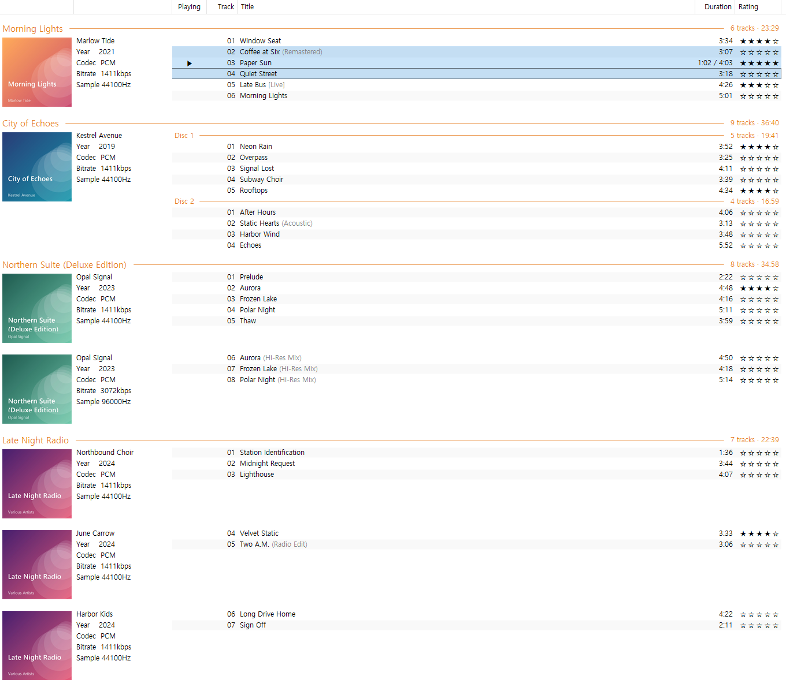

# fb2k-components

**English** · [한국어](README.ko.md)

Components for foobar2000 64-bit, written from scratch.

| Component | What it is | Version |
|---|---|---|
| [GroupPlaylist](components/foo_groupplaylist/README.md) (`foo_groupplaylist`) | A playlist view that groups tracks, for example by album, with the album art beside each group. A 64-bit alternative to SimPlaylist. | 0.9.2 |

Download a component from the [Releases](https://github.com/ChickenBrocolli/fb2k-components/releases) page. Each release is named after its component, for example `foo_groupplaylist-v0.9.2`. How to install and use each component is in its own README.

These components are not affiliated with the authors of the components they replace.

## Requirements

- foobar2000 v2.0 or newer, 64-bit
- Default User Interface

## Repository layout

| Folder | Contents |
|---|---|
| `components/<name>/src` | The component's source code |
| `components/<name>/tests` | Unit tests that build with the standard library only |
| `tools` | Build, test and packaging scripts (PowerShell) |

## Building

You need Visual Studio 2022 (or its Build Tools) with the C++ desktop workload.

1. Put the [foobar2000 SDK](https://www.foobar2000.org/SDK) in `foobar2000_SDK/`.
2. Put the contents of the [WTL NuGet package](https://www.nuget.org/packages/wtl) (version 10) in `third_party/wtl/`.
3. Run `tools\package.ps1` in PowerShell. It writes the component file to `dist\`.

`tools\build-and-deploy.ps1` builds and copies the DLL into a portable foobar2000 in `foobar2000_x64/`, for testing.

## License

[MIT License](LICENSE). Third-party licenses are in [THIRD-PARTY-NOTICES.txt](THIRD-PARTY-NOTICES.txt).
