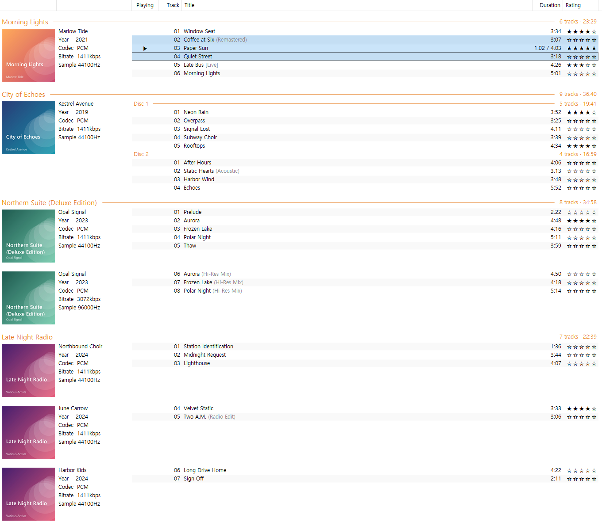
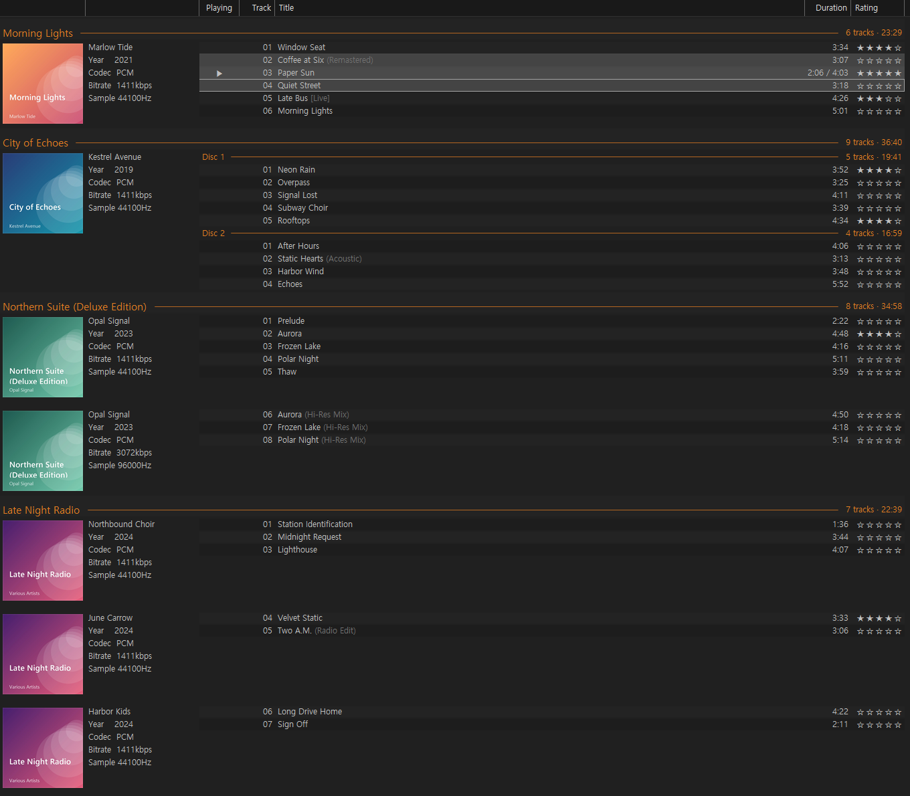
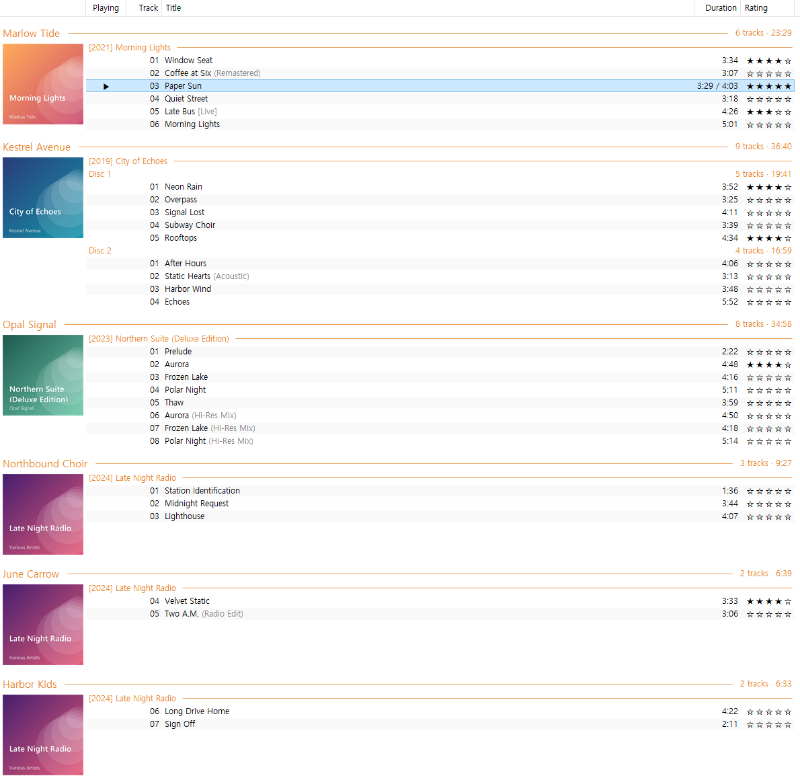
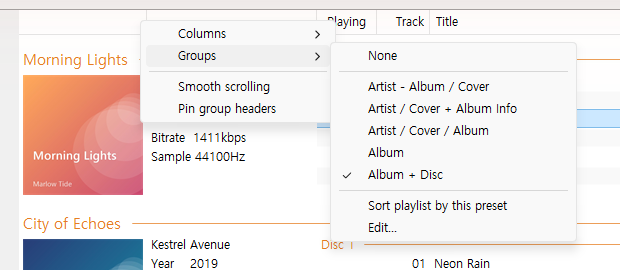
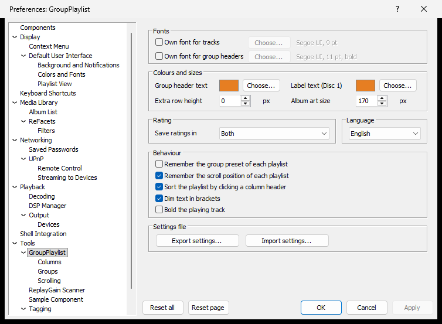

# GroupPlaylist

[English](README.md) · **한국어** · [fb2k-components](../../README.ko.md)의 일부

foobar2000 64비트용 재생목록 보기입니다. 재생목록의 곡을 앨범 같은 단위로 묶고, 묶음마다 옆에 앨범아트와 정보 칸을 보여 줍니다. `Disc 1`, `Disc 2` 같은 라벨로 묶음을 한 번 더 나눌 수도 있습니다.

*Album + Disc 프리셋으로 본 앨범 네 개. 폴더 하나에 아티스트 하나인 앨범, 상위 폴더 아래 Disc 1·Disc 2 하위 폴더가 있는 앨범, 보너스 곡만 샘플레이트가 높아서 표지 묶음이 따로 생긴 앨범, 아티스트 세 명이 섞여서 아티스트마다 표지 묶음이 생긴 앨범입니다.*

GroupPlaylist는 SimPlaylist의 64비트 대안입니다. 처음부터 새로 만든 프로그램이며 SimPlaylist의 원작자와는 관계가 없습니다.

- 타이틀 포맷 패턴으로 묶음과 라벨을 정합니다. 바로 쓸 수 있는 프리셋(Album, Album + Disc, Artist / Cover / Album 등)이 있고, 묶지 않고 보통 목록으로 볼 수도 있습니다.
- 기본 열 22개와 직접 만드는 열
- 클릭해서 매기는 별점. 파일 태그나 재생 통계(Playback Statistics)에 저장합니다.
- Default UI의 색, 글꼴, 다크 모드를 따릅니다.
- 영어와 한국어

## 스크린샷

| 다크 모드 | Artist / Cover / Album 프리셋 |
|---|---|
|  |  |

| 패널 메뉴(열 제목 오른쪽 클릭) | Preferences > Tools > GroupPlaylist |
|---|---|
|  |  |

스크린샷의 앨범은 지어낸 것입니다. `tools\make-screenshot-tracks.ps1`이 만듭니다. 화면은 영어로 찍었습니다.

## 필요한 것

- foobar2000 v2.0 이상, **64비트**. foobar2000 v2.26.3과 Windows 11에서, 화면 배율 100%와 150%로 시험했습니다.
- Default UI(기본 화면). Columns UI에서는 쓸 수 없습니다.
- 선택: 공식 [Playback Statistics](https://www.foobar2000.org/components/view/foo_playcount) 컴포넌트(`foo_playcount`). 별점을 파일 태그 대신 그 데이터베이스에 저장하려면 필요합니다.

## 설치

1. [Releases](https://github.com/ChickenBrocolli/fb2k-components/releases) 페이지에서 `foo_groupplaylist-<버전>.fb2k-component` 파일을 받습니다.
2. foobar2000에서 **File > Preferences > Components**를 엽니다.
3. **Install...** 단추를 누르고 받은 파일을 고릅니다.
4. 라이선스 창이 뜨면 **Accept**를 누릅니다.
5. **Apply**를 누르고, 다시 시작할지 묻는 창에서 **OK**를 누릅니다.

다시 시작하면 설치된 컴포넌트 목록에 **GroupPlaylist**가 보입니다.

지우려면 같은 목록에서 GroupPlaylist를 오른쪽 클릭해 **Remove**를 고르고 **Apply**를 누릅니다.

## 화면에 패널 넣기

1. **View > Layout > Enable layout editing mode**를 켭니다.
2. 재생목록으로 바꿀 패널(예: 지금 쓰는 재생목록)을 오른쪽 클릭해 **Replace UI Element...** 항목을 고릅니다. 다른 패널 옆에 더하려면 칸 나누기 막대를 오른쪽 클릭해 **Add New UI Element...** 항목을 고릅니다.
3. **Playlist Views** 아래의 **GroupPlaylist**를 고릅니다.
4. **View > Layout > Enable layout editing mode**를 다시 눌러 편집 모드를 끕니다.

## 패널 쓰기

패널의 **열 제목**을 오른쪽 클릭하면 메뉴가 열립니다.

| 항목 | 하는 일 |
|---|---|
| **열** | 보일 열을 체크합니다. **편집...** 항목은 설정의 열 페이지를 엽니다. |
| **그룹** | 이 재생목록을 묶는 방식을 고릅니다. **묶지 않음**은 보통 곡 목록으로 보여 줍니다. **이 프리셋으로 재생목록 정렬**은 프리셋의 순서로 재생목록을 정렬합니다. **편집...** 항목은 설정의 그룹 페이지를 엽니다. |
| **부드러운 스크롤** | 마우스 휠로 굴리면 줄 단위로 뛰지 않고 미끄러지다 멈춥니다. 처음부터 켜져 있습니다. 정밀 터치패드는 원래대로 스크롤합니다. |
| **그룹 머리글 고정** | 묶음 안을 스크롤하는 동안 그 묶음의 머리글을 패널 맨 위에 붙여 둡니다. |

그 밖에 할 수 있는 일:

- 앨범 표지를 클릭하면 그 표지의 곡이 모두 선택되고, 더블클릭하면 재생됩니다.
- 앨범 표지를 오른쪽 클릭하면 앨범아트를 다시 읽거나 들어 있는 폴더를 열 수 있습니다.
- 묶음 머리글을 더블클릭하면 그 묶음을 재생합니다.
- 묶음 머리글이나 디스크 라벨을 끌면 묶음이나 디스크 전체가 옮겨집니다.
- 열 제목을 클릭하면 그 열로 재생목록을 정렬하고, 한 번 더 누르면 거꾸로 정렬합니다. 표지 위의 빈 제목을 누르면 프리셋의 순서로 돌아갑니다. 정렬은 **Edit > Undo**(Ctrl+Z)로 되돌릴 수 있습니다.
- **Ctrl**을 누른 채 마우스 휠을 돌리면 앨범아트가 커지거나 작아집니다.
- 재생 중인 곡의 **길이** 칸을 클릭하면 재생한 시간과 남은 시간이 번갈아 보입니다.

## 설정

**File > Preferences > Tools > GroupPlaylist**를 엽니다.

- **글꼴**: 곡 줄과 그룹 머리글의 글꼴을 직접 정합니다. 정하지 않으면 Default UI의 재생목록 글꼴을 씁니다.
- **색과 크기**: 그룹 머리글 글자색, 라벨 글자색, 줄 높이 추가, 앨범아트 크기.
- **별점**: 별을 눌렀을 때 별점을 저장할 곳. **파일 태그**, **재생 통계**, **둘 다** 가운데 고릅니다. 뒤의 두 가지는 따로 설치하는 Playback Statistics 컴포넌트(`foo_playcount`)가 있어야 합니다. 없으면 회색으로 바뀌고 "(재생 통계 컴포넌트 필요)"가 붙습니다.
- **언어**: **자동**은 Windows 표시 언어를 따릅니다(한국어 Windows면 한국어, 아니면 영어). **English**나 **한국어**를 고르면 그 언어로 고정됩니다. **Apply**를 누르면 패널과 이 페이지가 바로 바뀝니다. 설정 목록의 페이지 이름은 설정 창을 다시 열면 바뀝니다.
- **동작**: 재생목록마다 그룹 방식과 스크롤 위치 기억, 열 제목 클릭으로 정렬, `(Remastered)` 같은 괄호 안 글자 흐리게, 재생 중인 곡 굵게 표시.
- **설정 파일**: **설정 내보내기...**는 GroupPlaylist 설정 전체를 글자 파일로 저장하고, **설정 불러오기...**는 그 파일을 읽어 들입니다. 백업하거나 다른 컴퓨터로 옮길 때 씁니다. 재생목록마다 기억하는 프리셋과 스크롤 위치, 별점, 패널마다의 열 배치는 파일에 들어가지 않습니다.

그 아래에 페이지가 세 개 있습니다.

- **열**: 기본 열(고칠 수는 없지만 메뉴에 보일지 고르거나 복제해서 사본을 고칠 수 있음)과 직접 만든 열. 열의 내용은 [타이틀 포맷](https://wiki.hydrogenaud.io/index.php?title=Foobar2000:Title_Formatting_Reference) 패턴입니다. **필드 넣기**로 자주 쓰는 필드를 넣을 수 있고, 미리보기에 선택한 곡의 결과가 보입니다.
- **그룹**: 프리셋 목록. 프리셋마다 그룹 머리글 패턴, 표지 패턴(값이 같은 곡은 표지 하나를 함께 씀), 묶음 안 라벨 패턴(한 줄에 하나), 정렬 순서 패턴이 있습니다.
- **스크롤**: 그룹 머리글 고정과 부드러운 스크롤(패널 메뉴의 항목과 같음), 그리고 휠이 미끄러지는 느낌. **기본**, **가볍게**(바로 멈추고 별로 빨라지지 않음), **묵직하게**(길게 미끄러지고 빨리 돌리면 크게 빨라짐), 또는 숫자 다섯 개로 만든 내 세트 가운데 고릅니다. 바꾸면 스크롤에 바로 반영되고, **Apply**를 누르면 저장됩니다.

## 알려진 한계

- 64비트 foobar2000에서만 동작합니다.
- foobar2000은 주 모니터의 화면 배율로 그립니다. 배율이 다른 보조 모니터에서는 Windows가 창을 늘리거나 줄여 보여 주므로 조금 흐려 보일 수 있습니다.

## 라이선스

GroupPlaylist는 [MIT 라이선스](../../LICENSE)로 배포합니다.

foobar2000 SDK(Peter Pawlowski)와 Windows Template Library(Microsoft, WTL Team)를 써서 만들었고, 부드러운 스크롤은 [ui_helpers](https://github.com/reupen/ui_helpers)(Reupen Shah, BSD 3-Clause)의 코드를 고쳐 썼습니다. 이 라이브러리들의 라이선스는 [THIRD-PARTY-NOTICES.txt](../../THIRD-PARTY-NOTICES.txt)에 있고, 이 파일은 컴포넌트 파일 안에도 들어 있습니다.

## 소스에서 빌드하기

C++ 데스크톱 개발 도구가 포함된 Visual Studio 2022(또는 Build Tools)가 필요합니다.

1. [foobar2000 SDK](https://www.foobar2000.org/SDK)를 저장소 맨 위 폴더의 `foobar2000_SDK/`에 넣습니다.
2. [WTL NuGet 패키지](https://www.nuget.org/packages/wtl)(버전 10)의 내용을 `third_party/wtl/`에 넣습니다.
3. 저장소 맨 위 폴더에서 PowerShell로 `tools\package.ps1`을 실행합니다. 화면 글자마다 한국어가 있는지 확인하고, 자동 테스트를 돌리고, Release DLL을 빌드한 뒤 `dist\foo_groupplaylist-<버전>.fb2k-component`를 만듭니다.
