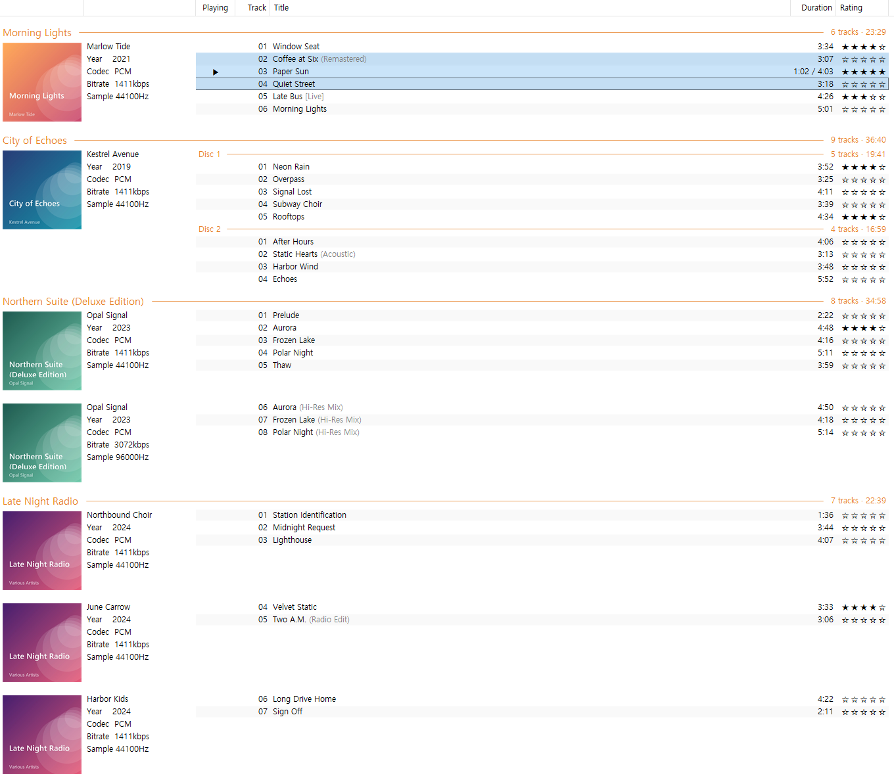
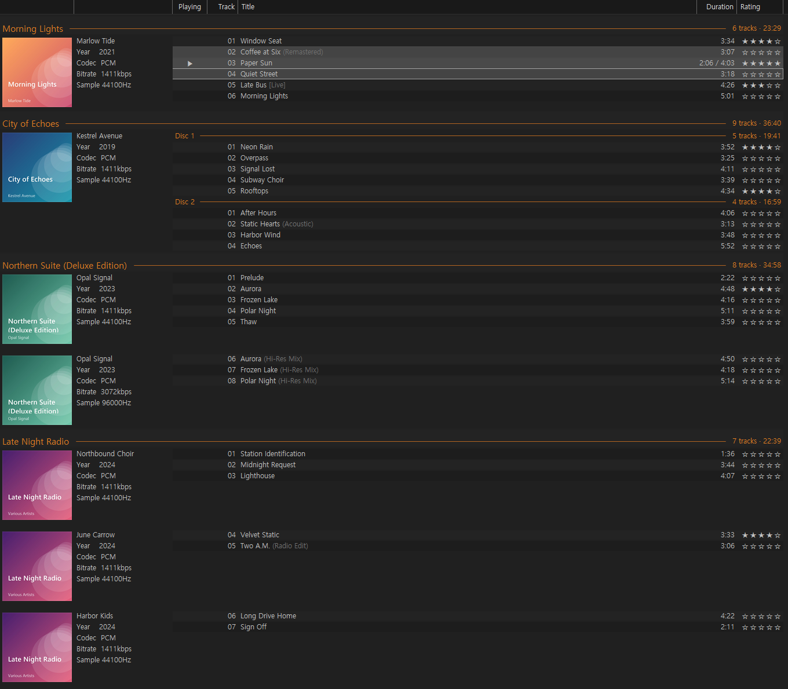
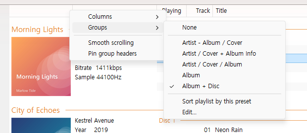
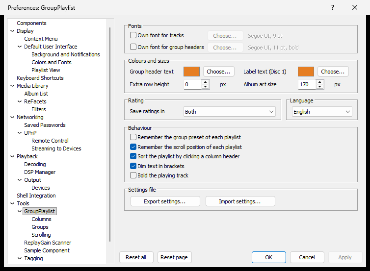

# GroupPlaylist

**English** · [한국어](README.ko.md) · Part of [fb2k-components](../../README.md)

A playlist view for foobar2000 64-bit. It groups the tracks of a playlist, for example by album, with the album art and an information column beside each group. Disc labels (`Disc 1`, `Disc 2`) can split a group further.

*Four albums in the Album + Disc preset: one folder with one artist; a main folder with Disc 1 and Disc 2 subfolders; an album whose bonus tracks have a higher sample rate, so they get a cover block of their own; and an album with three artists, one cover block each.*

GroupPlaylist is a 64-bit alternative to SimPlaylist. It is a new program written from scratch and is not affiliated with the author of SimPlaylist.

- Groups and labels made from title formatting patterns, with ready-made presets (Album, Album + Disc, Artist / Cover / Album and others), or no grouping at all
- 22 built-in columns plus your own columns
- Star ratings you click, kept in the file tags or in Playback Statistics
- Smooth scrolling that glides like a flicked list, with presets you can fine-tune
- Follows the Default UI colours, fonts and dark mode
- Settings export and import, for a backup or another computer
- English and Korean

## Screenshots

| Dark mode | Artist / Cover / Album preset |
|---|---|
|  |  |

| Panel menu (right-click a column title) | Preferences > Tools > GroupPlaylist |
|---|---|
|  |  |

| Preferences > Tools > GroupPlaylist > Scrolling |
|---|
|  |

The albums in the screenshots are made up: `tools\make-screenshot-tracks.ps1` writes them.

## Requirements

- foobar2000 v2.0 or newer, **64-bit**. Tested with foobar2000 v2.26.3 on Windows 11, at 100% and 150% display scaling.
- Default User Interface. Columns UI is not supported.
- Optional: the official [Playback Statistics](https://www.foobar2000.org/components/view/foo_playcount) component (`foo_playcount`), to keep ratings in its database instead of the file tags.

## Install

1. Download `foo_groupplaylist-<version>.fb2k-component` from the [Releases](https://github.com/ChickenBrocolli/fb2k-components/releases) page.
2. In foobar2000, open **File > Preferences > Components**.
3. Click **Install...** and choose the downloaded file.
4. foobar2000 shows the license. Click **Accept**.
5. Click **Apply**, then **OK** to restart foobar2000.

**GroupPlaylist** then appears in the list of installed components.

To remove it, right-click it in the same list, choose **Remove**, and click **Apply**.

## Add the panel to your layout

1. Open **View > Layout > Enable layout editing mode**.
2. Right-click the panel that should become the playlist (for example the current playlist view) and choose **Replace UI Element...**. To add it next to other panels instead, right-click a splitter and choose **Add New UI Element...**.
3. Under **Playlist Views**, choose **GroupPlaylist**.
4. Open **View > Layout > Enable layout editing mode** again to leave editing mode.

## Using the panel

Right-click a **column title** to open the panel menu:

| Item | What it does |
|---|---|
| **Columns** | Tick the columns to show. **Edit...** opens the Columns preferences page. |
| **Groups** | Choose how this playlist is grouped. **None** shows a plain track list. **Sort playlist by this preset** sorts the playlist in the preset's order. **Edit...** opens the Groups preferences page. |
| **Smooth scrolling** | The mouse wheel glides to a stop instead of jumping line by line. On by default. A precision touchpad scrolls as usual. Pick how it feels, **Default**, **Light**, **Heavy** or one of your own presets, and it takes effect at the next turn of the wheel; **Off** turns it off. Numbers you changed on the Scrolling page without saving them as a preset show as **Custom (unsaved)**; picking a preset leaves them behind. **Edit...** opens the Scrolling preferences page. |
| **Auto-size columns** | The columns fill the panel, so there is no horizontal scroll bar. They keep their proportions when the panel is resized, beside the cover and info columns, which keep their width. Dragging a column's edge moves only the border with the next column. Each panel has its own setting. It is on in a new panel; a panel set up with 0.9.0 keeps it off. |
| **Drag to reorder columns** | Drag column titles, the empty ones above the covers and the album text too, to put the columns in another order. Turn it off once you like the order, so a click or a resize cannot move a column by accident; widths can still be dragged. On by default. Also on the preferences page. |
| **Pin group headers** | Keeps the header of the group at the top of the panel while you scroll through it. |

Other things you can do in the panel:

- Click an album cover to select the tracks under it. Double-click it to play them.
- Right-click an album cover to reload its art or open its folder.
- Right-click the tracks for **Play**, **Remove**, **Crop**, **Sort**, **Cut**, **Copy** and **Paste**, followed by the usual foobar2000 commands. **Sort** changes the order of the selected tracks only: by a title formatting pattern you type, at random, reversed, or by album, artist, file path, title or track number. **Edit > Undo** (Ctrl+Z) undoes these changes.
- Double-click a group header to play the group.
- Drag a group header or a disc label to move the whole group or disc. A group goes only between groups, a disc only between discs.
- Click a column title to sort the playlist by that column, and click again to reverse. Click the empty title above the covers, or pick a preset under **Groups** right after such a sort, to return to the preset's order. **Edit > Undo** (Ctrl+Z) undoes a sort.
- Hold **Ctrl** and turn the mouse wheel to make the album art larger or smaller, or drag the right edge of the empty title above the covers.
- Drag the empty title above the covers, or the one above the album text beside them, to move that column anywhere among the other columns, for example the covers to the right end. Each panel keeps its own order.
- On the playing track, click the **Duration** cell to switch between the time played and the time left.

## Settings

Open **File > Preferences > Tools > GroupPlaylist**. A change on this page shows in the panels at once, so you can try it out. **Apply** or **OK** saves it, and **Cancel** puts the saved settings back. **Language** and **Rating** change only on **Apply**.

- **Fonts**: your own fonts for the tracks and for the group headers. Without them the panel uses the Default UI playlist font.
- **Colours and sizes**: the group header and label text follow foobar2000's highlight colour (Default UI colours) unless you tick **Own header colour** or **Own label colour** and pick one; extra row height, album art size.
- **Rating**: where a click on the stars saves the rating: **File tags**, **Playback Statistics**, or **Both**. The last two need the separate Playback Statistics component (`foo_playcount`). Without it they are greyed out and marked "(needs Playback Statistics)". Filled stars take foobar2000's highlight colour too, or a colour of your own with **Own star colour**.
- **Language**: **Automatic** follows the Windows display language (Korean on Korean Windows, English otherwise). **English** and **한국어** choose one. After **Apply** the panel and the page change at once. Reopen Preferences to see the page names in the new language.
- **Behaviour**: remember the group preset and the scroll position of each playlist, sort by clicking a column title, drag column titles to reorder the columns, dim text in brackets such as `(Remastered)`, show the playing track in bold, and show the track count and length on group headers, on label rows or on both (it can also be turned off).
- **Settings file**: **Export settings...** saves every GroupPlaylist setting to a text file, and **Import settings...** loads one, for a backup or another computer. Per-playlist presets and scroll positions, ratings, and each panel's column layout are not in the file.

Three pages sit below it:

- **Columns**: the built-in columns and your own columns. A built-in column cannot be removed, but you can change its name, pattern and alignment, choose whether it appears in the menu, and put it back with **Restore default**. A column's text is a [title formatting](https://wiki.hydrogenaud.io/index.php?title=Foobar2000:Title_Formatting_Reference) pattern. **Insert field** adds common fields, and the preview shows the result for the focused track.
- **Groups**: the presets. Each preset has a pattern for the group header, for the cover (tracks with the same value share one cover), for the labels inside a group (one per line), and for its sort order.
- **Scrolling**: pinned group headers and smooth scrolling (the same switches as in the panel menu), and how the wheel glides: **Default**, **Light** (stops at once, hardly speeds up), **Heavy** (glides long, speeds up a lot when you spin the wheel), or your own sets, made from five numbers. A change shows at once while you scroll; **Apply** keeps it. Once you change a number, the preset list shows **Custom (unsaved)** and offers an unused name such as "Custom preset 1"; **Save as new** keeps the numbers as a preset of their own, and **Overwrite** saves them into your preset they started from.

## Known limitations

- 64-bit foobar2000 only.
- foobar2000 draws at the display scaling of the main monitor. On a second monitor with a different scaling, Windows enlarges or shrinks the window, so it can look slightly blurred.

## License

GroupPlaylist is released under the [MIT License](../../LICENSE).

It is built with the foobar2000 SDK (Peter Pawlowski) and the Windows Template Library (Microsoft, WTL Team), and its smooth scrolling is adapted from [ui_helpers](https://github.com/reupen/ui_helpers) (Reupen Shah, BSD 3-Clause). Their licenses are in [THIRD-PARTY-NOTICES.txt](../../THIRD-PARTY-NOTICES.txt), which also ships inside the component file.

## Building from source

You need Visual Studio 2022 (or its Build Tools) with the C++ desktop workload.

1. Put the [foobar2000 SDK](https://www.foobar2000.org/SDK) in `foobar2000_SDK/` at the root of the repository.
2. Put the contents of the [WTL NuGet package](https://www.nuget.org/packages/wtl) (version 10) in `third_party/wtl/`.
3. From the root of the repository, run `tools\package.ps1` in PowerShell. It checks that every interface text has a Korean text, runs the unit tests, builds the Release DLL, and writes `dist\foo_groupplaylist-<version>.fb2k-component`.
